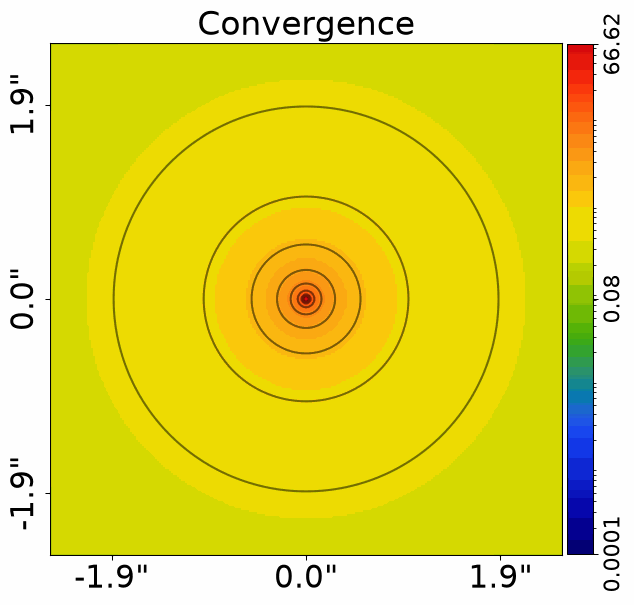
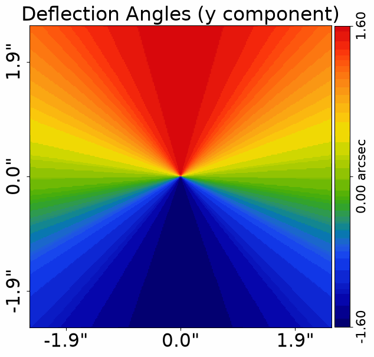
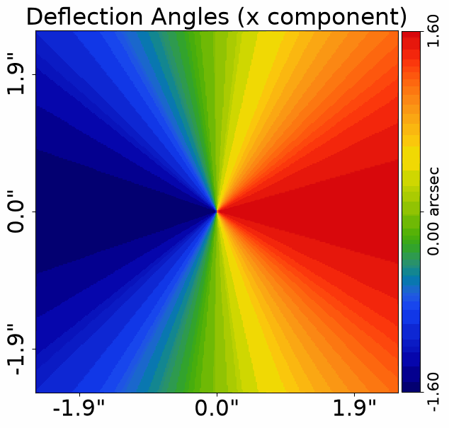
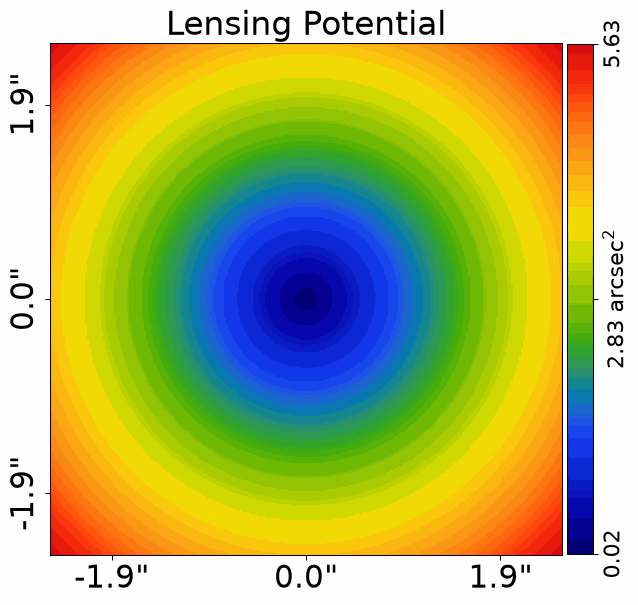
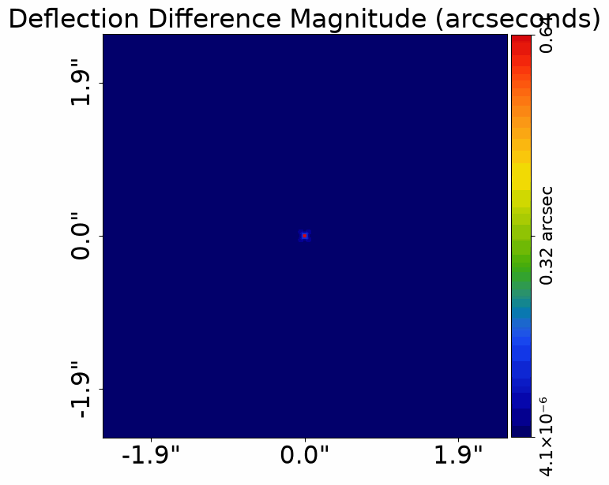
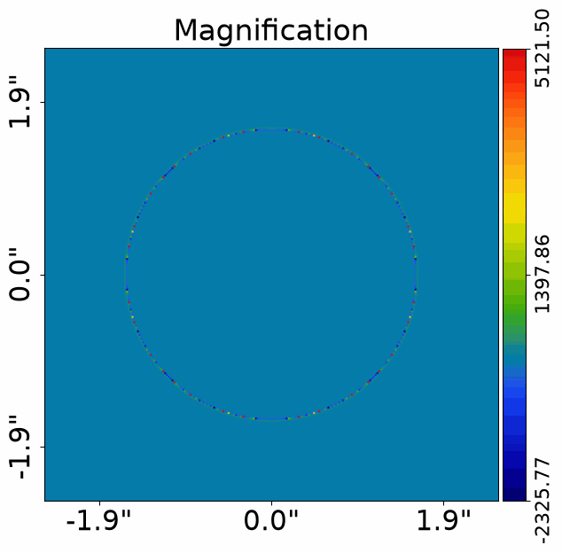
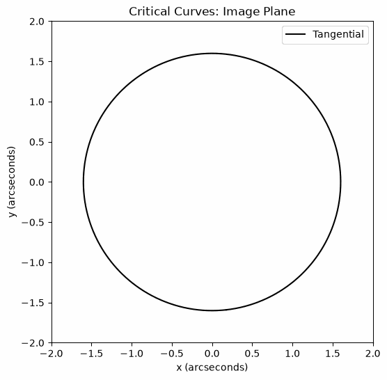
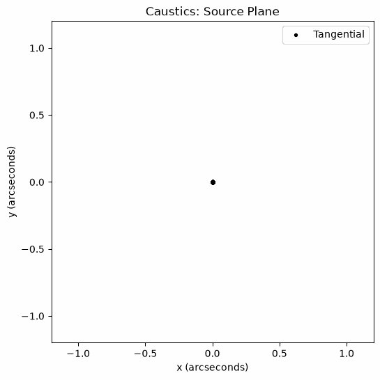
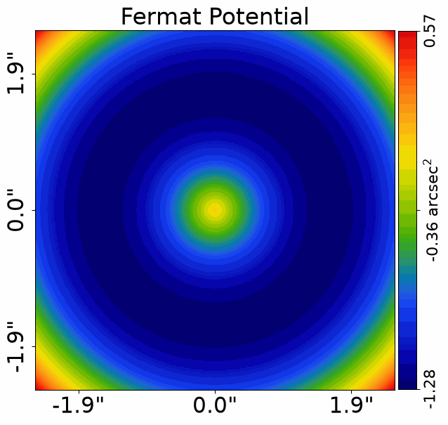

> ✏️ **This page is auto-generated from [`scripts/chapter_1_introduction/tutorial_3_more_ray_tracing.py`](../../scripts/chapter_1_introduction/tutorial_3_more_ray_tracing.py) — do not edit it directly.**
> It shows the example fully executed, with its real output images.
> Run it yourself via the [Python script](../../scripts/chapter_1_introduction/tutorial_3_more_ray_tracing.py) or the [Jupyter notebook](../../notebooks/chapter_1_introduction/tutorial_3_more_ray_tracing.ipynb).

Tutorial 3: More Ray Tracing
===========================

In tutorial 2, we used the lens equation to trace coordinates from
the image plane to the source plane and build an image of a
strong lens.

We will now connect that picture to the quantities used to describe
gravitational lensing: convergence, deflection angles, potential,
shear and magnification. We will also explain critical curves and
caustics, the Einstein radius and time delays.

This tutorial includes the mathematics behind these ideas, but
following every equation is optional. You can do strong-lensing
science with a physical understanding of how mass bends light,
changes image shapes and produces multiple images. PyAutoLens
performs the calculations; your job is to understand what your
model represents and what the observations can tell you.

Each mathematical section therefore explains the idea in words
and connects it to code or a figure. On a first pass, you can focus
on those explanations and outputs, then return to the equations
when you want to understand a calculation in more detail.

We assume you are familiar with the lens equation from tutorial 2.

__Contents__

- **Initial Setup:** Create the image-plane grid.
- **Concise Code:** Build a familiar lens and source in fewer steps.
- **Cosmological Distances:** Define the distances used in lensing.
- **Convergence:** Express projected mass as a dimensionless density.
- **Deflection Angles:** Relate the mass distribution to ray tracing.
- **The Lensing Potential:** Connect deflections and convergence through a scalar field.
- **Shear and Magnification:** Describe changes in image shape, area and total brightness.
- **Critical Curves and Caustics:** Locate strong stretching and its source-plane counterpart.
- **Einstein Radius:** Connect the scale of a strong lens to its enclosed projected mass.
- **Time Delays:** Explain why different images arrive at different times.
- **Wrap Up:** Review the physical meaning of the lensing quantities.
- **Env:** Preserve the grid used to resolve the critical curves.


```python

from autolens import jax_wrapper  # Sets JAX environment before other imports

from autolens import setup_notebook; setup_notebook()

import matplotlib.pyplot as plt
import numpy as np
import autoarray as aa
import autolens as al
import autolens.plot as aplt
```

    Working Directory has been set to `HowToLens`


__Initial Setup__

We begin with a grid of 250 by 250 image-plane coordinates,
separated by 0.02 arcseconds. It covers a field 5 arcseconds across
and samples the lens more finely than the grids used earlier.

We will call it `grid` from now on. Unless we explicitly trace it
to another plane, its coordinates are in the image plane.

The two printed shapes show the grid's arrangement and its total
number of coordinates.


```python

grid = al.Grid2D.uniform(shape_native=(250, 250), pixel_scales=0.02)

print(grid.shape_native)
print(grid.shape_slim)
```

    (250, 250)
    62500


__Concise Code__

Let's build a lens and source using the same approach as tutorial 2.
We can define each profile directly inside its galaxy, keeping the
whole system together in a short block of code.

The lens has a spherical isothermal mass profile at redshift 0.5.
The source has a spherical light profile at redshift 1.0 and is
centred behind the lens.

We will use this tracer throughout the mathematical sections,
with the same default cosmology as tutorial 2.


```python

lens = al.Galaxy(
    redshift=0.5,
    mass=al.mp.IsothermalSph(centre=(0.0, 0.0), einstein_radius=1.6),
)

source = al.Galaxy(
    redshift=1.0,
    light=al.lp.SersicCoreSph(
        centre=(0.0, 0.0),
        intensity=1.0,
        effective_radius=1.0,
        sersic_index=1.0,
        radius_break=0.025,
    ),
)

tracer = al.Tracer(galaxies=[lens, source])
mass_profile = lens.mass
cosmology = tracer.cosmology
lens_calc = al.LensCalc.from_tracer(tracer=tracer)
```

__Cosmological Distances__

In tutorial 2, we converted angular sizes into kiloparsecs.
The distance used in that conversion is called the
**angular diameter distance**.

It relates an object's physical size, $l$, perpendicular to our
line of sight to its angular size, $\theta$:

$$
l = D\,\theta.
$$

Here $D$ is the angular diameter distance and $\theta$ must be
expressed in radians.

Three angular diameter distances describe the geometry of our
lens system:

- $D_l$: from the observer to the lens.
- $D_s$: from the observer to the source.
- $D_{ls}$: from the lens to the source.

These distances account for the expansion of the Universe.
In general, $D_{ls}$ is not equal to $D_s - D_l$.

The cosmology calculates each distance from the relevant
redshifts. The values below are in kiloparsecs.


```python

D_l = cosmology.angular_diameter_distance_to_earth_in_kpc_from(redshift=0.5)
D_s = cosmology.angular_diameter_distance_to_earth_in_kpc_from(redshift=1.0)
D_ls = cosmology.angular_diameter_distance_between_redshifts_in_kpc_from(
    redshift_0=0.5, redshift_1=1.0
)

print(f"Observer to lens: {D_l:.3e} kpc")
print(f"Observer to source: {D_s:.3e} kpc")
print(f"Lens to source: {D_ls:.3e} kpc")
```

    Observer to lens: 1.297e+06 kpc
    Observer to source: 1.698e+06 kpc
    Lens to source: 7.252e+05 kpc


One radian contains approximately 206,265 arcseconds. The
conversion used in tutorial 2 therefore follows directly:

$$
l\;[\mathrm{kpc}]
=
\frac{D\;[\mathrm{kpc}]}{206265}
\,\theta\;[\mathrm{arcsec}].
$$

For a lens-plane size we use $D_l$; for a source-plane size
we use $D_s$. The third distance, $D_{ls}$, enters the lensing
strength through the geometry between the lens and source.

The physical deflection angle, $\hat{\boldsymbol{\alpha}}$,
describes how much the light ray bends as it passes the lens.
The displacement used in our lens equation also accounts for
the distances between observer, lens and source:
$\boldsymbol{\alpha} = (D_{ls}/D_s)\hat{\boldsymbol{\alpha}}$.
This is called the **reduced deflection angle**.

The deflections returned by PyAutoLens are these reduced angles,
expressed in arcseconds. They are the displacement we subtract
from an image-plane position to obtain its source-plane position,
as we did in tutorial 2. We will continue to call them
"deflection angles" throughout this tutorial.

__Convergence__

Imagine adding up the lens galaxy's mass along our line of sight.
The result is its **surface mass density**, $\Sigma$: mass per
unit area projected onto the lens plane.

For a galaxy-scale lens, we usually treat the deflection as
occurring in one thin plane. Within this approximation, this
projected distribution describes how the galaxy's mass bends
the light.

The same projected mass distribution has a different lensing
strength for different lens and source distances. We account
for that geometry using the **critical surface density**:

$$
\Sigma_{\mathrm{cr}}
=
\frac{c^2}{4\pi G}
\frac{D_s}{D_l D_{ls}},
$$

where $c$ is the speed of light and $G$ is Newton's gravitational
constant.

Dividing the surface mass density by this reference value gives
the **convergence**:

$$
\kappa(\boldsymbol{\theta})
=
\frac{\Sigma(\boldsymbol{\theta})}{\Sigma_{\mathrm{cr}}}.
$$

Convergence is therefore dimensionless. A value of 0.5 means
that the local surface mass density is half the critical
surface density for this lens and source geometry.

Let's calculate the critical surface density in solar masses
per square kiloparsec, then plot our lens's convergence.


```python

sigma_cr_kpc = (
    cosmology.critical_surface_density_between_redshifts_solar_mass_per_kpc2_from(
        redshift_0=0.5, redshift_1=1.0
    )
)

print(
    "Critical surface density: "
    f"{sigma_cr_kpc:.3e} solar masses per square kiloparsec"
)

convergence = tracer.convergence_2d_from(grid=grid)

aplt.plot_array(array=convergence, title="Convergence", use_log10=True, cb_unit="")
```

    Critical surface density: 3.002e+09 solar masses per square kiloparsec





The convergence is largest near the centre and decreases
outwards, following the projected mass distribution of our
isothermal lens.

Convergence values of order one indicate surface densities
relevant to strong lensing. For a circular lens, the Einstein
radius encloses a region whose **mean convergence** is one:
the average surface mass density inside it equals
$\Sigma_{\mathrm{cr}}$.

This is an average over the enclosed area, rather than the
convergence at its edge. We will return to this connection
when we use the Einstein radius to measure the lens's mass.

__Deflection Angles__

The convergence describes the projected mass distribution.
To calculate a ray's deflection, we add the contributions
from mass across the lens plane:

$$
\boldsymbol{\alpha}(\boldsymbol{\theta})
=
\frac{1}{\pi}
\int
\kappa(\boldsymbol{\theta}')
\frac{\boldsymbol{\theta}-\boldsymbol{\theta}'}
{|\boldsymbol{\theta}-\boldsymbol{\theta}'|^2}
\,d^2\boldsymbol{\theta}'.
$$

Here $\boldsymbol{\theta}$ is the position where we want the
deflection, while $\boldsymbol{\theta}'$ runs over the mass
distribution. The integral adds the contribution from each
small patch of projected mass.

The deflection therefore depends on more than the mass at
the ray's position. Surrounding mass contributes too, which
is why the satellite galaxy and external shear in tutorial 2
could change the source images.

For our spherical isothermal profile, this integral has an
analytic solution. PyAutoLens evaluates that solution when
we call `deflections_yx_2d_from`; other profiles may use
numerical calculations.

Let's plot the two components of the reduced deflection angle,
in arcseconds, as we did in tutorial 2.


```python

deflections = tracer.deflections_yx_2d_from(grid=grid)

deflections_y = aa.Array2D(values=deflections.slim[:, 0], mask=grid.mask)
deflections_x = aa.Array2D(values=deflections.slim[:, 1], mask=grid.mask)

aplt.plot_array(
    array=deflections_y, title="Deflection Angles (y component)", cb_unit=" arcsec"
)
aplt.plot_array(
    array=deflections_x, title="Deflection Angles (x component)", cb_unit=" arcsec"
)
```








Each component changes sign across the lens centre. Together,
they describe the displacement we subtract from each
image-plane coordinate when tracing it to the source plane.

__The Lensing Potential__

We can describe the same lens using a single scalar field:
the **lensing potential**, $\psi$.

Its gradient gives the deflection angles:

$$
\boldsymbol{\alpha} = \nabla\psi.
$$

A gradient describes how a quantity changes with position.
Here, the change in potential along the y direction gives
the y deflection, and the change along x gives the x deflection.

The convergence is related to the potential's second
derivatives:

$$
\kappa
=
\frac{1}{2}\nabla^2\psi
=
\frac{1}{2}
\left(
\frac{\partial^2\psi}{\partial\theta_y^2}
+
\frac{\partial^2\psi}{\partial\theta_x^2}
\right).
$$

The symbol $\nabla^2$, called the Laplacian, means adding
these two second derivatives. This relation is the
two-dimensional Poisson equation for gravitational lensing.

We can therefore describe the projected mass through
convergence, or describe its lensing effect through the
potential. Their spatial derivatives connect the two.

Let's plot the potential of our lens. With coordinates and
deflections in arcseconds, its units are arcseconds squared.


```python

potential = tracer.potential_2d_from(grid=grid)

aplt.plot_array(array=potential, title="Lensing Potential", cb_unit=r" arcsec$^2$")
```





For this spherical lens, the potential has circular contours.
Its slope points radially outwards, matching the direction
of the deflection vectors used in our lens equation.

We can check $\boldsymbol{\alpha} = \nabla\psi$ directly.

First, we calculate the deflections using the mass profile's
analytic expression. Then we estimate them from changes in
the potential between neighbouring grid points.

The two calculations should agree closely over most of the
grid. Numerical differentiation is less accurate near the
central cusp and at the grid boundaries.

We will plot the magnitude of the difference between the
two deflection vectors at each grid point, in arcseconds.
Brighter regions indicate larger differences. We also print
the median of these magnitudes to summarise the typical
difference across the grid.


```python

deflections_analytic = mass_profile.deflections_yx_2d_from(grid=grid)
deflections_via_potential = mass_profile.deflections_2d_via_potential_2d_from(
    grid=grid
)

difference_yx = (
    np.asarray(deflections_analytic) - np.asarray(deflections_via_potential)
)

difference_magnitude = np.sqrt(np.sum(difference_yx**2, axis=1))

difference_map = aa.Array2D(values=difference_magnitude, mask=grid.mask)

aplt.plot_array(
    array=difference_map,
    title="Deflection Difference Magnitude (arcseconds)",
    cb_unit=" arcsec",
)

print(
    "Median deflection difference magnitude: "
    f"{np.median(difference_magnitude):.3e} arcsec"
)
```





    Median deflection difference magnitude: 3.134e-05 arcsec


__Shear and Magnification__

Nearby rays generally experience slightly different deflections.
Those differences change an image's shape and size.

To describe this locally, we calculate how each deflection
component changes with position. Since deflections are
derivatives of the potential, these are its second derivatives.
Together they form the **Hessian matrix**:

$$
H_{ij}
=
\frac{\partial^2\psi}
{\partial\theta_i\,\partial\theta_j}.
$$

The indices $i$ and $j$ each stand for y or x. The diagonal
entries describe changes along the same coordinate direction;
the other entries describe changes across the two directions.

Differentiating the lens equation gives the **Jacobian matrix**:

$$
A
=
\frac{\partial\boldsymbol{\beta}}
{\partial\boldsymbol{\theta}}
=
I-H.
$$

Here $I$ is the identity matrix. The Jacobian maps a small
image-plane displacement to a source-plane displacement:

$$
\delta\boldsymbol{\beta}
=
A\,\delta\boldsymbol{\theta}.
$$

Its inverse, where it exists, tells us how a small source
region is stretched into an image.

`LensCalc` calculates the Hessian from the tracer's
deflection field.


```python

hessian_yy, hessian_xy, hessian_yx, hessian_xx = lens_calc.hessian_from(grid=grid)

print(f"H_yy at the first grid point: {hessian_yy[0]:.4f}")
print(f"H_xx at the first grid point: {hessian_xx[0]:.4f}")
```

    H_yy at the first grid point: 0.2272
    H_xx at the first grid point: 0.2272


The Hessian separates into two useful contributions.

The **convergence** describes the part that acts equally
in every direction:

$$
\kappa = \frac{1}{2}(H_{xx}+H_{yy}).
$$

This is the same convergence we defined from surface mass
density earlier.

The **shear** describes the directional part of the distortion.
Its two components are

$$
\gamma_1 = \frac{1}{2}(H_{xx}-H_{yy}),
\qquad
\gamma_2 = H_{xy},
$$

with magnitude

$$
|\gamma| = \sqrt{\gamma_1^2+\gamma_2^2}.
$$

These components describe the strength and orientation of
the distortion. Shear allows a circular source to form an
elongated image.

In tutorial 2, we added an external shear to represent the
effect of surrounding matter. Here we calculate the shear
produced by the lens itself. Even a spherical mass distribution
produces shear: its symmetry does not mean that radial and
tangential image stretching are equal.

Let's calculate the shear and print its magnitude at the
first grid point.


```python

shear = lens_calc.shear_yx_2d_via_hessian_from(grid=grid)

print(
    "Shear magnitude at the first grid point: "
    f"{shear.magnitudes[0]:.4f}"
)
```

    Shear magnitude at the first grid point: 0.2272


The **magnification**, $\mu$, describes the change in area
between a small source region and its image:

$$
\mu
=
\frac{1}{\det A}
=
\frac{1}{(1-\kappa)^2-|\gamma|^2}.
$$

Its absolute value gives the area ratio. Lensing preserves
surface brightness, so increasing the area also increases
the total light received from that source region.

- $|\mu| > 1$: the image region is magnified.
- $|\mu| < 1$: it is demagnified.
- $\mu < 0$: its orientation is reversed, like a reflection.

Magnification varies across an extended source, so its total
brightness depends on the combined contributions from its
different regions.

Let's plot the signed magnification across the image plane.
Look for the circular region where its magnitude becomes
large and its sign changes.


```python

magnification = lens_calc.magnification_2d_from(grid=grid)

aplt.plot_array(
    array=magnification,
    title="Magnification",
    cb_unit="",
)
```





For our spherical lens, we can separate the stretching into
two directions: tangentially around the lens centre and
radially towards or away from it.

The corresponding eigenvalues of the Jacobian are

$$
\lambda_t = 1-\kappa-|\gamma|,
\qquad
\lambda_r = 1-\kappa+|\gamma|.
$$

The image stretches by factors $1/|\lambda_t|$ and
$1/|\lambda_r|$ along these directions. Their product gives
the absolute magnification.

When an eigenvalue approaches zero, the stretching in its
direction becomes very large. This is how long, thin arcs
can form.


```python

tangential_eigen_values = lens_calc.tangential_eigen_value_from(grid=grid)
radial_eigen_values = lens_calc.radial_eigen_value_from(grid=grid)

print(
    "Tangential eigenvalue at the first grid point: "
    f"{tangential_eigen_values[0]:.4f}"
)
print(
    "Radial eigenvalue at the first grid point: "
    f"{radial_eigen_values[0]:.4f}"
)
```

    Tangential eigenvalue at the first grid point: 0.5456
    Radial eigenvalue at the first grid point: 1.0000


__Critical Curves and Caustics__

**Critical curves** mark positions in the image plane where
the magnification of an infinitesimally small source formally
becomes infinite:

$$
\det A = 0.
$$

A tangential critical curve occurs where $\lambda_t=0$;
a radial critical curve occurs where $\lambda_r=0$.
Images near them can be strongly stretched in the
corresponding direction.

Real galaxies have finite size. They can form bright,
extended arcs near critical curves without having
infinite total brightness.

Our spherical isothermal lens has a tangential critical
curve but no radial critical curve. The plot below should
therefore show one circle, at a radius of 1.6 arcseconds.


```python

tangential_critical_curves = (
    lens_calc.tangential_critical_curve_list_from(
        grid=grid, pixel_scale=grid.pixel_scale
    )
)
radial_critical_curves = (
    lens_calc.radial_critical_curve_list_from(
        grid=grid, pixel_scale=grid.pixel_scale
    )
)

fig, ax = plt.subplots(figsize=(6, 6))

for curves, colour, label in [
    (tangential_critical_curves, "black", "Tangential"),
    (radial_critical_curves, "orange", "Radial"),
]:
    for index, curve in enumerate(curves):
        coordinates = np.asarray(curve)
        ax.plot(
            coordinates[:, 1],
            coordinates[:, 0],
            color=colour,
            label=label if index == 0 else None,
        )

ax.set(
    title="Critical Curves: Image Plane",
    xlabel="x (arcseconds)",
    ylabel="y (arcseconds)",
    xlim=(-2.0, 2.0),
    ylim=(-2.0, 2.0),
)
ax.set_aspect("equal")
ax.legend()
plt.show()
plt.close(fig)
```





Ray-tracing a critical curve to the source plane gives
a **caustic**:

$$
\boldsymbol{\beta}_{\mathrm{caustic}}
=
\boldsymbol{\theta}_{\mathrm{critical}}
-
\boldsymbol{\alpha}(
    \boldsymbol{\theta}_{\mathrm{critical}}
).
$$

Critical curves tell us where strongly stretched images
appear. Caustics tell us where a source must lie to
produce those images.

For our spherical lens, the entire tangential critical
circle maps to one source-plane point: the origin.
A source centred there produces an Einstein ring.

The plot below displays the mapped coordinates as points.
They should gather at the origin, with any small spread
arising from the numerical calculation.


```python

tangential_caustics = lens_calc.tangential_caustic_list_from(
    grid=grid, pixel_scale=grid.pixel_scale
)
radial_caustics = lens_calc.radial_caustic_list_from(
    grid=grid, pixel_scale=grid.pixel_scale
)

fig, ax = plt.subplots(figsize=(6, 6))

for caustics, colour, label in [
    (tangential_caustics, "black", "Tangential"),
    (radial_caustics, "orange", "Radial"),
]:
    for index, caustic in enumerate(caustics):
        coordinates = np.asarray(caustic)
        ax.scatter(
            coordinates[:, 1],
            coordinates[:, 0],
            s=8,
            color=colour,
            label=label if index == 0 else None,
        )

ax.set(
    title="Caustics: Source Plane",
    xlabel="x (arcseconds)",
    ylabel="y (arcseconds)",
    xlim=(-1.2, 1.2),
    ylim=(-1.2, 1.2),
)
ax.set_aspect("equal")
ax.legend()
plt.show()
plt.close(fig)
```





We can reveal a radial critical curve by making the lens's
central mass distribution shallower.

The code below replaces the spherical isothermal profile
with a spherical power-law profile whose slope is 1.8.
The isothermal slope is 2.0. We keep the same centre,
Einstein-radius parameter, source and cosmology.


```python

lens = al.Galaxy(
    redshift=0.5,
    mass=al.mp.PowerLawSph(
        centre=(0.0, 0.0),
        einstein_radius=1.6,
        slope=1.8,
    ),
)

tracer = al.Tracer(galaxies=[lens, source], cosmology=cosmology)
mass_profile = lens.mass
lens_calc = al.LensCalc.from_tracer(tracer=tracer)
```

Rerun the two plotting cells immediately above, including
their critical-curve and caustic calculations.

The image-plane plot should now show an inner radial critical
curve as well as the outer tangential critical curve.
The source-plane plot should show a circular radial
caustic around the central tangential caustic.

Caustics also mark changes in the number of images.
For a point source crossing a smooth part of the radial
caustic in this example, two images appear or disappear.
An extended galaxy can straddle the caustic, so different
parts of it can have different numbers of images.

The following cell restores our spherical isothermal lens
for the remaining sections.


```python

lens = al.Galaxy(
    redshift=0.5,
    mass=al.mp.IsothermalSph(
        centre=(0.0, 0.0),
        einstein_radius=1.6,
    ),
)

tracer = al.Tracer(galaxies=[lens, source], cosmology=cosmology)
mass_profile = lens.mass
lens_calc = al.LensCalc.from_tracer(tracer=tracer)
```

__Einstein Radius__

For a circular lens with a source directly behind its centre,
the source forms an Einstein ring. Its angular radius is
the **Einstein radius**, $\theta_E$.

Our spherical isothermal lens has a circular tangential
critical curve at this radius.

For a non-circular lens, we can define an **effective Einstein
radius** using the area enclosed by the tangential critical
curve:

$$
\theta_E = \sqrt{\frac{A_{\mathrm{crit}}}{\pi}}.
$$

This is the radius of a circle enclosing the same area.
It is the definition used by `LensCalc`.

Let's recover the Einstein radius from our critical curve
and convert it into kiloparsecs at the lens redshift.


```python

einstein_radius = lens_calc.einstein_radius_from(
    grid=grid, pixel_scale=grid.pixel_scale
)

kpc_per_arcsec_lens = cosmology.kpc_per_arcsec_from(
    redshift=lens.redshift
)
einstein_radius_kpc = einstein_radius * kpc_per_arcsec_lens

print(f"Einstein radius: {einstein_radius:.4f} arcsec")
print(f"Einstein radius: {einstein_radius_kpc:.4f} kpc")
```

    Einstein radius: 1.6000 arcsec
    Einstein radius: 10.0612 kpc


The recovered angular radius should be close to the
1.6 arcseconds specified in our spherical mass profile.
Small differences arise from locating the critical curve
on a finite grid.

Two simple mass distributions have useful expressions
for the Einstein radius.

For a point mass $M$:

$$
\theta_E
=
\sqrt{
\frac{4GM}{c^2}
\frac{D_{ls}}{D_l D_s}
}.
$$

For a singular isothermal sphere, with one-dimensional
velocity dispersion $\sigma_v$:

$$
\theta_E
=
4\pi
\left(\frac{\sigma_v}{c}\right)^2
\frac{D_{ls}}{D_s}.
$$

Both expressions give angles in radians when the physical
quantities use consistent units.

They show how the Einstein radius connects the lens's mass
or velocity dispersion to the observer–lens–source geometry.
Our `IsothermalSph` profile specifies this angular scale
directly through its `einstein_radius` parameter.

For a circular lens, the mean convergence inside the Einstein
radius equals one. Its enclosed projected mass is therefore

$$
M(<R_E)
=
\pi R_E^2\,\Sigma_{\mathrm{cr}},
$$

where $R_E$ is the physical Einstein radius.

We already have $R_E$ in kiloparsecs and the critical surface
density in solar masses per square kiloparsec, so their
combination gives the enclosed mass in solar masses.


```python

einstein_mass_solar = np.pi * einstein_radius_kpc**2 * sigma_cr_kpc

print(
    "Projected mass inside the Einstein radius: "
    f"{einstein_mass_solar:.3e} solar masses"
)
```

    Projected mass inside the Einstein radius: 9.546e+11 solar masses


This is one of strong lensing's most useful measurements.
The image positions constrain the Einstein scale, often
giving a tighter constraint on the enclosed projected mass
than on how that mass is distributed within it.

For non-circular lenses, the effective Einstein radius remains
a useful summary of the lensing scale, but the circular
enclosed-mass relation is not generally exact. The detailed
mass model and surrounding matter still matter.

__Time Delays__

Different images of the same source follow different paths
past the lens and arrive at different times. The path lengths
and gravitational potential both contribute to the delay.

For a fixed source position $\boldsymbol{\beta}$, these
contributions form the **Fermat potential**:

$$
\phi(\boldsymbol{\theta};\boldsymbol{\beta})
=
\frac{1}{2}
|\boldsymbol{\theta}-\boldsymbol{\beta}|^2
-
\psi(\boldsymbol{\theta}).
$$

Images form at stationary points of this surface, where
its gradient is zero. This reproduces the lens equation.

The arrival-time difference between images A and B is

$$
t_A-t_B
=
\frac{1+z_l}{c}
\frac{D_l D_s}{D_{ls}}
\left(\phi_A-\phi_B\right).
$$

For this time-delay expression, angles must be in radians
and the distance and time units must be consistent.

Below, we plot the Fermat potential in arcseconds squared
for the centre of our source. We keep that source position
fixed while evaluating different image-plane positions.
For our aligned spherical example, the stationary ring
lies at the Einstein radius.


```python

source_centre = np.asarray(source.light.centre)
displacements = np.asarray(grid) - source_centre

geometric_term = 0.5 * np.sum(displacements**2, axis=1)
potential = tracer.potential_2d_from(grid=grid)

fermat_potential = aa.Array2D(
    values=geometric_term - np.asarray(potential),
    mask=grid.mask,
)

aplt.plot_array(
    array=fermat_potential,
    title="Fermat Potential",
    cb_unit=r" arcsec$^2$",
)
```





For a variable source, such as a quasar or supernova, the
same brightness variation can appear in different images
at different times. Measuring those delays provides
information about cosmological distances as well as
the lens's mass distribution.

__Wrap Up__

The quantities in this tutorial describe different aspects
of the same ray-tracing calculation:

- **Convergence** expresses projected mass relative to the
  critical surface density.
- **Deflections** map image-plane coordinates to source-plane
  coordinates.
- **Potential** connects the deflections, convergence and
  shear through its derivatives.
- **Shear and magnification** describe local changes in
  image shape, area and total brightness.
- **Critical curves and caustics** identify where strong
  stretching occurs and the corresponding source positions.
- **Einstein radius** connects the scale of a strong lens
  to its enclosed projected mass.
- **Time delays** connect differences in arrival time to
  the lens potential and cosmological distances.

You do not need to memorise these equations to continue.
The physical picture from tutorial 2 remains the foundation:
mass changes the mapping between image and source coordinates,
and that mapping determines the images we observe.

Return to the equations when you want to understand a
calculation more deeply or connect a quantity in a lensing
paper to the code that evaluates it.

**🤖 Ask AI:** Why can strong lensing tightly constrain the
mass enclosed near the Einstein radius while leaving more
uncertainty about the mass profile's slope?

In tutorial 4, we turn to point sources, whose individual
lensed images provide another way to study a lens.
